# Arsitektur aplikasi dan deploy

```mermaid
flowchart LR
  Browser[Browser: Vue 3] -->|HTTPS| Caddy[Caddy reverse proxy]
  Caddy --> Express[Node.js + Express API]
  Express --> Middleware[Helmet, CORS, cookie parser, CSRF]
  Middleware --> Router[apiRoutes]
  Router --> Controller[Controllers]
  Controller --> Service[Domain services]
  Controller --> Models[Sequelize models]
  Service --> Models
  Models -->|prepared/bound queries| MySQL[(MySQL / Docker volume)]
  Express -->|static files production| Browser
  GitHub[GitHub main] --> Actions[GitHub Actions deploy]
  Actions -->|pinned SSH forced command| VPS[VPS Docker Compose]
  VPS --> Caddy
```

## Request routing

`client/src/api.js` mengirim request same-origin ke `/api`. `server/src/routes/apiRoutes.js` memasang route; `server/src/middleware/csrf.js` memeriksa request yang mengubah data. Route privat melewati `requireAuth`; route pengelolaan akun, produk, dan supplier mengizinkan Admin serta Dosen. Controller memvalidasi/menyusun response, service menampung logika lintas model, Sequelize memetakan model ke MySQL, lalu Vue memperbarui state dari JSON. Staff dapat mencatat pergerakan stok, tetapi tidak mengelola akun atau master produk/supplier.

## Lingkungan dan deployment

- Lokal: `.env` + MySQL Docker development + Vite dev server.
- Production: `.env` di VPS, container app + MySQL privat + Caddy. MySQL tidak mengekspos port publik.
- `.env` menyimpan password database, JWT signing secret, SMTP, dan kredensial seed. File tersebut tidak masuk Git; `.env.example` hanya berisi konfigurasi lokal/dummy.
- GitHub Actions hanya deploy ketika secret host/key pinning tersedia dan deploy diaktifkan. Forced command membatasi SSH key ke skrip deployment.
- Container volume menjaga data saat redeploy, tetapi bukan pengganti backup terenkripsi di luar VPS.

## Peta routing MVC

| Modul | Route API | Controller | Model utama | Hak akses tulis |
| --- | --- | --- | --- | --- |
| Produk | `/api/products` | `productController` | `Product`, `Category`, `Supplier`, `ProductImage` | Admin |
| Supplier | `/api/suppliers` | `supplierController` | `Supplier` | Admin |
| Pergerakan stok | `/api/stock-movements` | `stockMovementController` + `stockService` | `StockMovement`, `Product`, `User` | Admin, Dosen, Staff |
| Pengguna | `/api/users` | `userController` | `User`, `StockMovement` | Admin |
| Autentikasi | `/api/auth/*` | `authController` | `User`, `PasswordReset` | Publik/akun sendiri |
