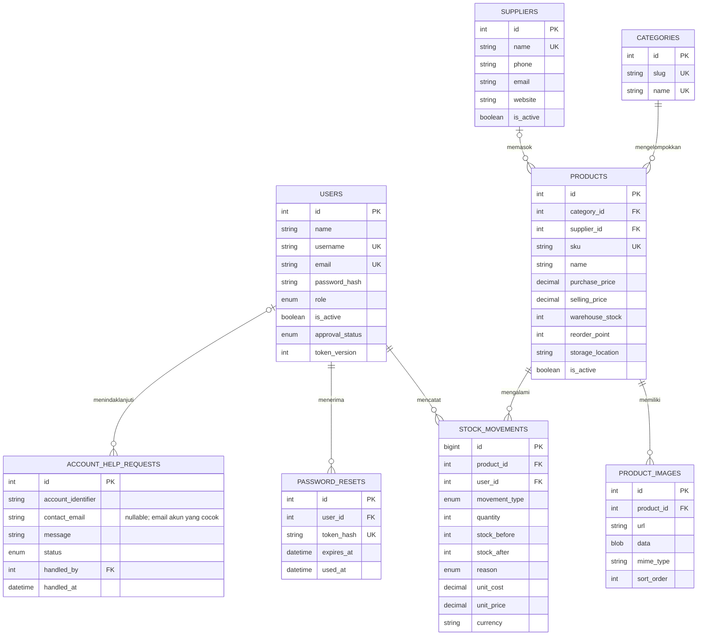

# ERD KeyStock

ERD ini mengikuti delapan tabel aplikasi dan relasi foreign key pada MySQL. Produk yang diarsipkan memakai `is_active = false`; riwayat stok tidak dihapus saat produk diarsipkan.

## Kardinalitas dan alasan

- Satu kategori mengelompokkan banyak produk; setiap produk wajib memiliki satu kategori (`products.category_id`, `ON DELETE RESTRICT`).
- Satu supplier dapat memasok banyak produk; produk boleh belum memiliki supplier (`products.supplier_id`, `ON DELETE SET NULL`).
- Satu produk dapat memiliki beberapa foto dan catatan pergerakan. Foto ikut dihapus jika produk dihapus secara fisik; produk aktif dalam aplikasi diarsipkan secara soft delete. Riwayat pergerakan menolak penghapusan fisik produk (`ON DELETE RESTRICT`).
- Satu pengguna mencatat banyak pergerakan stok. Catatan menyimpan saldo sebelum/sesudah dan snapshot harga untuk audit serta laporan historis.
- Satu pengguna dapat memiliki beberapa catatan reset sandi. Token asli tidak disimpan, hanya hash; catatan reset ikut dibersihkan saat akun dihapus (`ON DELETE CASCADE`).
- Permintaan bantuan lupa kata sandi dicatat tanpa mengungkap ke pengirim apakah akun cocok. Sistem mengambil `contact_email` dari alamat akun yang cocok; field ini nullable jika username/email tidak ditemukan. Admin meninjau identitas dan menindaklanjuti secara manual; `handled_by` menjadi foreign key opsional yang dikosongkan jika akun Admin dihapus (`ON DELETE SET NULL`).

Seed membuat peran Admin (`admin`), Dosen (`dosen`), dan Staff (`staff`). Dosen memiliki hak administratif yang sama dengan Admin; Staff dapat melihat inventaris dan mencatat pergerakan stok, tetapi tidak mengelola produk, supplier, atau akun.
